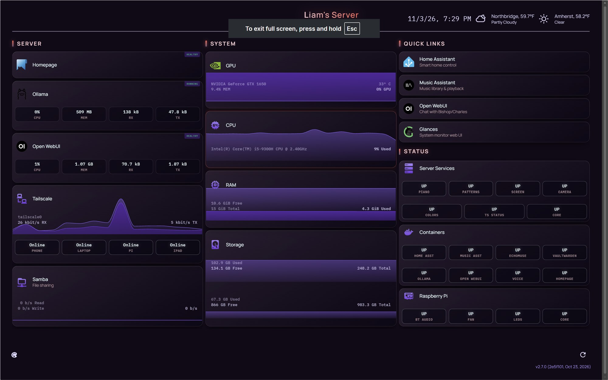
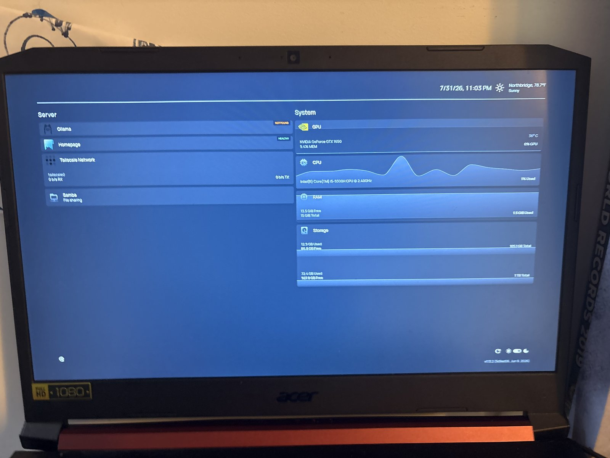

# Kiosk Display

The laptop's own screen shows the dashboard with no desktop environment.

**Packages:** `xserver-xorg x11-xserver-utils xinit openbox chromium-browser unclutter`

**Flow:** autologin on tty1 (getty override) runs `startx` via `~/.bash_profile`, which runs `~/.xinitrc`, which starts Openbox and then a small loop script (`kiosk-loop.sh`) that keeps Chromium running in `--kiosk` mode pointed at `http://localhost:3000`.

**Gotcha:** without a short `sleep 2` between starting Openbox and Chromium, Chromium rendered at half-screen because no window manager was ready.

**Tradeoff:** autologin means physical access equals a shell. SSH still requires normal authentication. This was a deliberate choice.

**Screen toggle:** `scripts/screentoggle.sh` flips DPMS state. Make sure `.bash_profile` sources `.bashrc`, or the alias won't exist in SSH sessions and typing `screen` launches GNU Screen instead.

## Refreshing the kiosk

`scripts/kiosk-refresh` kills the kiosk Chromium; the loop script relaunches it. This is more reliable than sending keystrokes with `xdotool`, which often missed the window.

## No periodic reload

An old cron job (`xdotool key F5` every 15 minutes) and a `location.reload()` in `custom.js` both reloaded the page, which flashed the screen white and reset the hardware graphs. Both were removed. Homepage widgets already poll on their own.

## Service status panel

A small Python service (`docker/service-status/status.py`, port 5099, run by `systemd/service-status.service`) checks systemd units, Docker containers, and the Raspberry Pi (over SSH with a dedicated key), caches the result every 30 seconds, and returns JSON. Homepage shows it as three groups of tiles (Server Services, Containers, Raspberry Pi) using `customapi` widgets.

- Each tile can cover several units, and shows `UP`, or `DOWN: unit, unit` naming what failed.
- `customapi` allows only 4 fields per widget, so the script splits tiles into rows of 4 (`status.py --yaml` prints the Homepage YAML).
- The Pi is checked through `systemctl is-active` over SSH rather than per-service API ports, so it needs no extra open ports.

## Equal-height columns

Homepage lays each group out as a heading followed by a collapsible panel, with the tile list nested inside the panel. Stretching the columns therefore means making every wrapper between the group and its list a growing flex container. Stylesheet rules alone never won (something sets the panel to `display: block`), so `custom.js` applies the same rules as inline `!important` styles every 2 seconds. See `docker/homepage/custom.css` and `custom.js`.

**Side effect to know about:** because those inline styles are `!important`, any later CSS that changes a list item's layout must use `position: absolute` or padding rather than flex direction. The status header below uses that approach.

## Colour theme

The palette theme (`docker/homepage/theme/`) restyles the dashboard without changing the layout: deep plum background, rounded gradient cards, uppercase group headings with an accent bar, and status colours on the stat blocks (up = ice blue, warning = blush, down = coral). Homepage's `color:` setting only accepts named palettes, and `customapi` values can't be coloured natively, so a few lines of JS tag each block `ok` / `warn` / `bad` from its text and the CSS colours them.

`scripts/palette-theme on|off` installs or removes the theme as marked blocks inside `custom.css`, `custom.js`, and `settings.yaml`. Every run validates the YAML and the JS first and saves the previous files to a timestamped `theme/backups/` folder. `palette-theme off` restores the originals exactly.

The three status groups live inside the Quick Links column, so their "Status" heading is a CSS pseudo-element placed above the fifth Quick Links tile rather than a real Homepage group (a real group would become a fourth column).

Earlier look, before the status panel and theme:

